# Optimization of Wireless Sensor Network Deployment for Improving Flower Pollination Algorithm (Matlab Code)

​  
Editor
📚2 Running Results 2.1 No Obstacles Edit
Editor
Editor
Editor
Editor
Editor
Editor
Editor
2.2 Editors with obstacles
Editor
Editor
Editor
Part of the code:
p=0.8;% judge whether it is global optimization or local optimization
L = 50;% length
W = 50;% width
% Assuming each square meter has one grid.
M = 2500;% total number of grids
r_max = 7;% Perception radius is 5
r_mid = 6;  
r_min = 5;  
energy_max = 100;% maximum energy
energy_mid = 90;  
energy_min = 80;  
per_sersons_radius_type = [r_max,r_mid,r_min];  
% Assuming large, medium, and small are 5, the remaining are small.
N = 25;%30 sensor nodes
sizepop = 50;% population size
dimension = 2;% Spatial dimension: First row for x and y, third row for radius.
ger = 10;% maximum number of iterations
pos_limit = [0, 50];% Set position parameter limit
% Quantity limit
r_max_num = 1;%Numbers from 1 to 5
r_mid_num = 2;% Order number is 6-10
r_min_num = N - r_max_num - r_mid_num; % Sequence number is from 11 to N.
struct_pop_per = struct('per',[],'radius',[],'energy_init',[],'energy_end',[],'sersons_num',[]); %Structural Types
struct_pops_temp = repmat(struct_pop_per,[1 sizepop]); % A temporary population
energy_init_arr = zeros(1,N);  
energy_end_arr = zeros(1,N);  
radius_arr = zeros(1,N);  
% Calculate the four points of a trapezoid.
syms x y;% Define a variable first.
% Top left
k1 = 1;  
b1 = 35;  
x1_up = solve(k1*x+b1==50, x);%Upper left corner of the diagonal line
y1_down = solve(k1*0+b1==y,y);  
% Lower left corner
k2 = -1;  
b2 = 15;  
y2_up = solve(k2*0+b2==y,y);  
x2_down = solve(k2*x+b2==0,x);  
%Top right
k3 = -1;  
b3 = 85;  
x3_up = solve(k3*x+b3==50,x);  
y3_down = solve(k3*50+b3==y,y);  
% Bottom right corner
k4 = 1;  
b4 = -35;  
y4_up = solve(k4*50+b4==y,y);  
x4_down = solve(k4*x+b4==0,x);  
% The data validation is complete, and it is completely correct.
point = zeros(8,2);% Store these points from left to right and top to bottom.
point(1,:) = [x1_up,50];  
point(2,:) = [0,y1_down];  
point(3,:) = [0,y2_up];  
point(4,:) = [x2_down,0];  
point(5,:) = [x3_up,50];  
point(6,:) = [50,y3_down];  
point(7,:) = [50,y4_up];  
point(8,:) = [x4_down,0];  
% Calculation of diamonds
point_diamond = zeros(2,4);% Diamond's four points, orientation is clockwise. The first column is up, the second column is right.
% Calculate the four points of a new diamond shape.
syms x y;% Define a variable first.
% Top left
k5 = 1;  
b5 = 10;  
%No need for calculations, it's clear to see directly.
point_diamond(1,1) = 25;  
point_diamond(2,1) = 35;  
%Top right
k6 = -1;  
b6 = 60;  
point_diamond(1,2) = 35;  
point_diamond(2,2) = 25;  
% Bottom right corner
k7 = 1;  
b7 = -10;  
point_diamond(1,3) = 25;  
point_diamond(2,3) = 15;  
% Lower left corner
k8 = 1;  
b8 = 40;  
point_diamond(1,4) = 15;  
point_diamond(2,4) = 25;  
Load struct_pop_public.mat;% Load this population
struct_pops = struct_pop_public;% Obtain population data
Load struct_first_init_public.mat% Load the first individual data
struct_first_init = struct_first_init_public;% Obtain the initialized individual data
🎉3 References
🌈4 Matlab code implementation

## Images

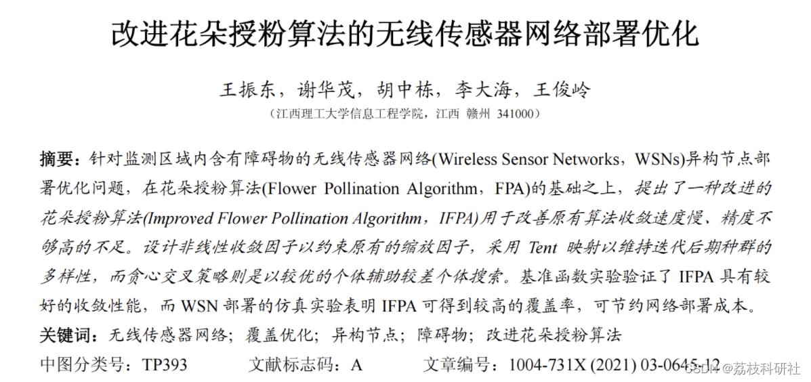
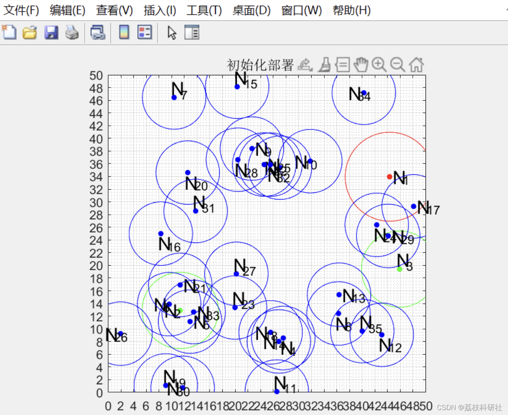
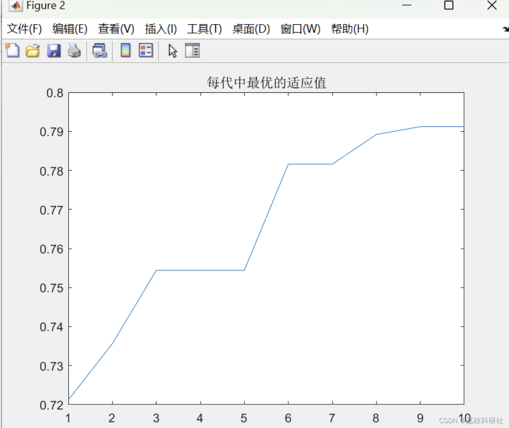
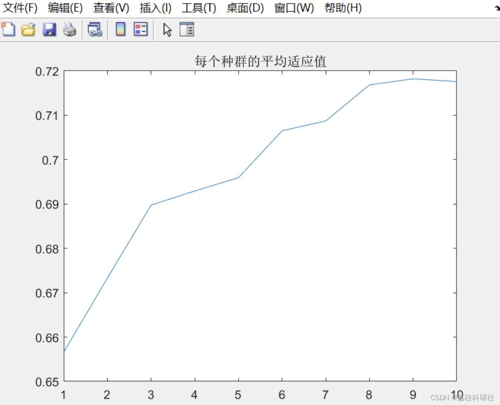
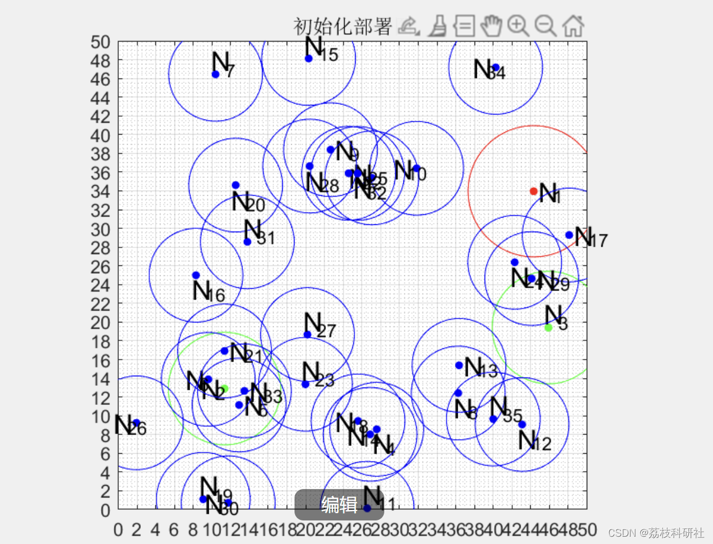
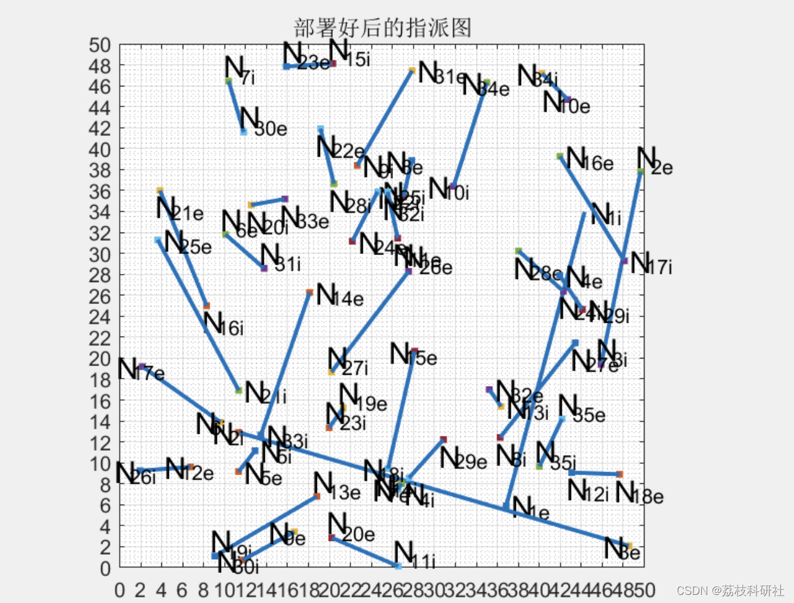
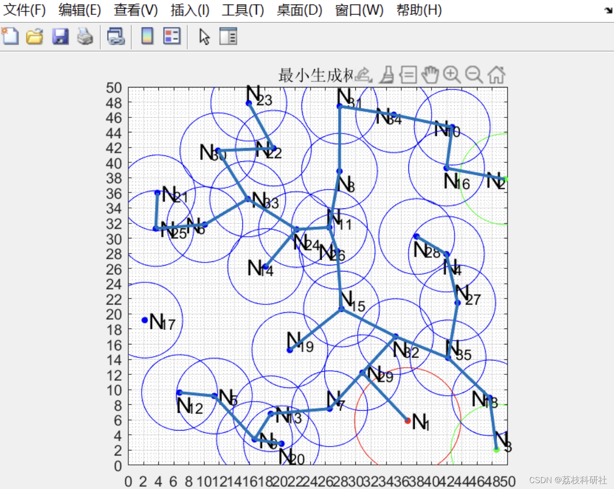
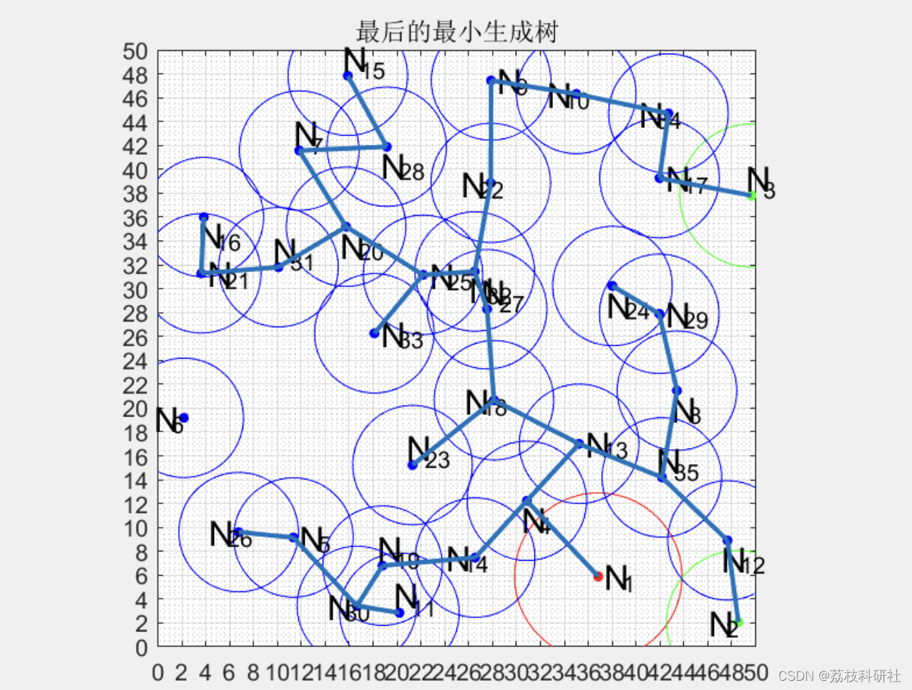
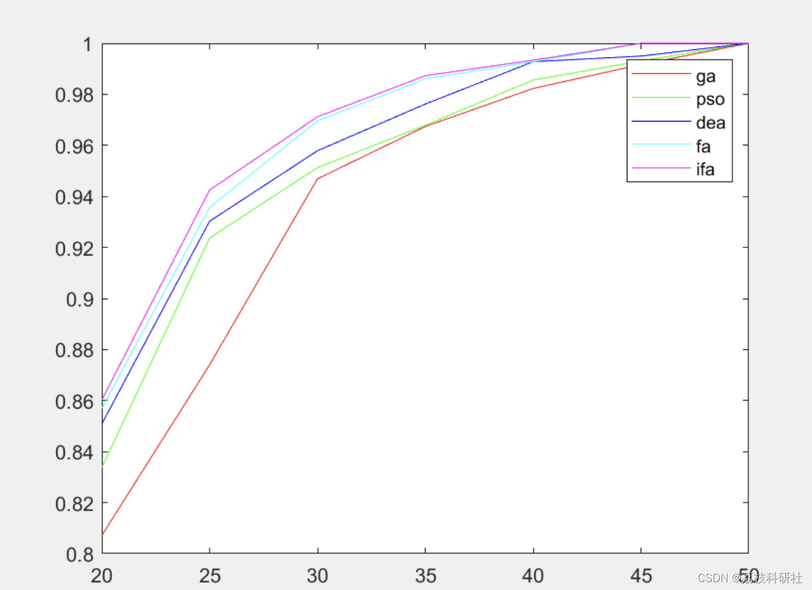
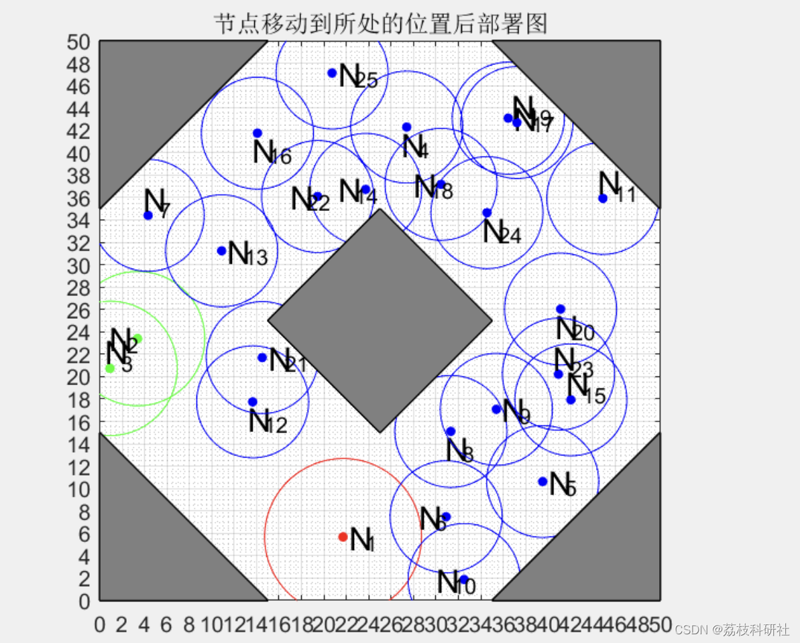
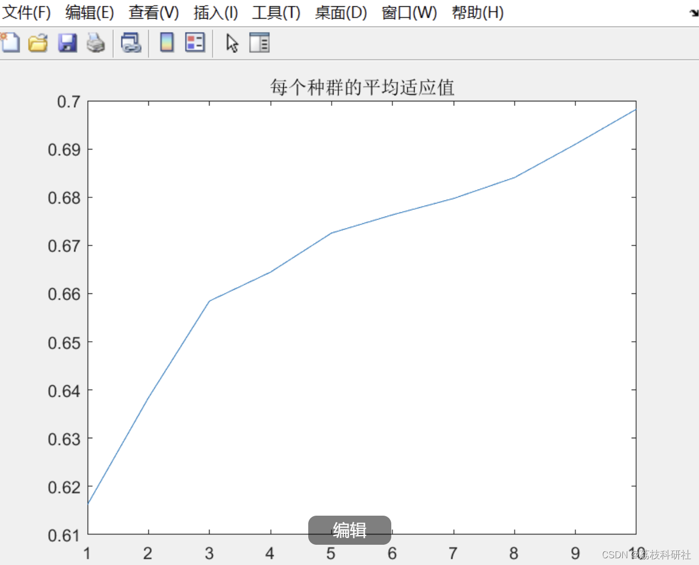
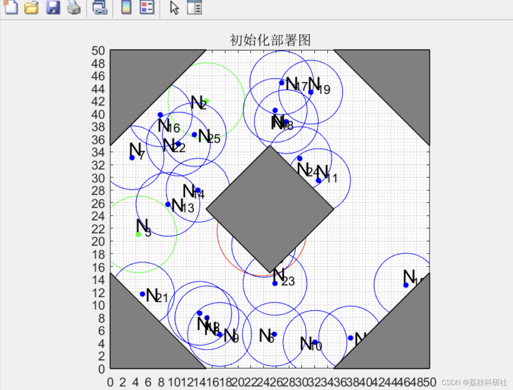
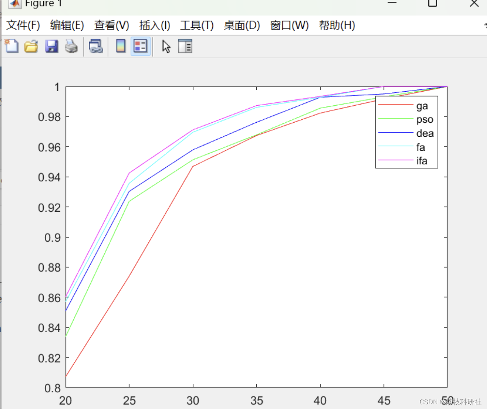

<!-- PAYMENT_BLOCK -->

## Get this dataset

- Payment link (Stripe): [Buy now](https://buy.stripe.com/3cs8yP7sY87d0vu9AB)
- Payment QR code: 

<!-- /PAYMENT_BLOCK -->
